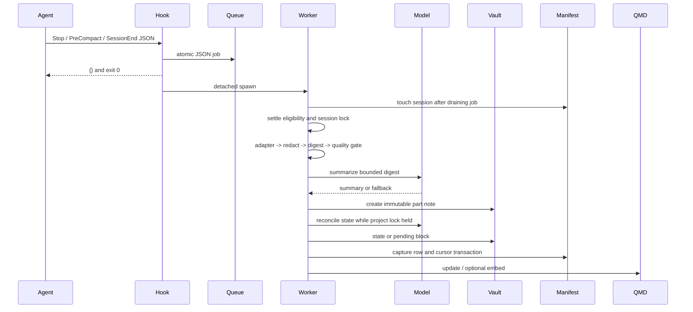

# Current system and evidence

All repository references are relative to `C:/Users/caspe/Documents/Projects/agent-memory` at `03764f8`, except references prefixed `HX/`, which refer to `../herdr-orchestration` at `367ab17`. Line references describe these snapshots and must be refreshed when the implementation branch differs.

## Inspection boundaries

VERIFIED. The working tree initially had no tracked changes. There is no repository-root AGENTS.md in either inspected checkout. CodeDB returned `SnapshotLoadFailed`; exact source reads and ripgrep were used. The source package has 18 Python modules, two test modules, fixture helpers, three integration skills, one OpenCode plugin, a runner, and an installer. `docs/ASSESSMENT.md` is historical design evidence, not a runtime inventory.

The shared vault rules and the Agent Memory project note were read. `mem search "AgentMem" --layer current` failed because its configured Python executable could not run in this environment. The project note was therefore read directly. Its historical operational claims were treated as leads only, not as current execution evidence. The source suite passed during this investigation. No private journal, unrelated transcript corpus, credentials, or live financial data was inspected.

## Module inventory

| Component and evidence | Verified responsibility | Persistence or dependency |
|---|---|---|
| `run.py`; `agentmem/cli.py:316 main` | CLI parsing and dispatch | Stable deployed runner used by hooks |
| `config.py:13 Config`, `:68 load` | Runtime defaults and vault paths | `AGENTMEM_HOME`, explicit vault, environment, runtime config |
| `hook.py:14 _context`, `:43 main` | Recall pointer, enqueue, exception isolation | SessionStart reads overview and manifest |
| `worker.py:20 enqueue`, `:28 drain_queue`, `:43 run` | JSON file jobs, worker lock, processing and indexing | `_meta/queue`, locks, manifest |
| `worker.py:78 sleep_then_run`, `:93 spawn_detached` | Settle-window sleeper and detached subprocess | No continuously running service |
| `adapters.py:27 Event`, `:38 Transcript` | Common event stream | User and assistant text, command and edit metadata |
| `adapters.py:80 read_claude`, `:137 read_codex`, `:210 read_opencode` | Parse provider formats | JSONL bytes for Claude/Codex; message index for OpenCode |
| `extract.py:58 build`, `:92 _gate`, `:106 _render` | Redacted digest, quality gate, bounded input | 45,000-character default; tool outputs omitted |
| `llm.py:54 _run`, `:96 summarize`, `:119 consolidate` | Isolated Claude CLI calls | No tools, no persisted model session; timeout/fallback |
| `pipeline.py:60 finalize`, `:140 consolidate_into_project` | Capture and project reconciliation | Session lock, project lock, note then manifest |
| `pipeline.py:165 consolidate_pending` | Reprocess deferred reconciliation | Stored summary or reread transcript |
| `manifest.py:12 SCHEMA`, `:36 Manifest` | Sessions/captures, cursor, retry, statistics | SQLite WAL, BEGIN IMMEDIATE |
| `notes.py:35 render_session`, `:113 update_project_note` | Immutable note format, managed-block updates | Atomic replacement; preserves unmanaged text |
| `projects.py:132 resolve_session`, `:161 resolve` | Route cwd/files/first prompt | `_meta/projects.json`, longest root match |
| `remember.py:70 remember_item`, `:132 capture_current` | Explicit memory and current-session capture | Evidence note plus reconciliation or remembered resource |
| `search.py:86 search`, `:111 fallback_search` | QMD keyword or vector search, fallback scan | Five PARA collections; folder-derived labels |
| `fsutil.py:18 atomic_write`, `:39 create_once`, `:68 file_lock` | Replacement, create-once, advisory lock | Windows/POSIX implementations |
| `redact.py:68 redact`, `:79 is_sensitive_path` | Pattern and entropy filtering | No general personal-data classifier |
| `logutil.py:9 log` | Structured operational logging | Vault log file, rotation |
| `install.py:38 deploy_app`, `:78 wire_claude`, `:94 wire_codex`, `:147 main` | Copy runtime, wire integrations, predeploy test gate | Writes global runtime and settings, not run here |

## Existing records

`sessions` is keyed by `(agent, session_id)`. It holds source, cwd, project, status, captured_until, parts, end_seen, activity times, attempts, next_try, last_error, and skip_reason. Status values documented in the schema are pending, captured, skipped, error, and legacy. They are plain text, not CHECK-constrained enums.

`captures` is keyed by `(agent, session_id, part)`. It records note_path, project, title, date, start/end offsets, summarizer, consolidated flag, reported cost, digest hash, capture timestamp, and summary JSON. `record_capture` commits capture and cursor together. `INSERT OR REPLACE` is used for capture rows. Notes and the database are not one transaction.

`Event` contains role, kind, text, tool, paths, timestamp, and final flag. It has no exact per-event transcript locator. `Transcript` contains source, identity, cwd, title, start/end timestamps, cursor range, and events. An adapter-observed command means the command was present in a transcript. It does not prove command success, because tool outputs are excluded.

The vault uses `0-Sessions/YYYY/MM`, `1-Projects/
/
.md`, `2-Areas`, `3-Resources`, `4-Archive`, and `_meta`. Project notes have state, pending, and recent-session managed blocks. The state block contains four fixed headings. Recent session links are capped at 15. Session notes contain summary, decisions/rationale, confirmed facts, file/command metadata, and a transcript path/range. These are useful source references but are not statement-level proof.

## Representative lifecycle

For a synthetic Claude session, `worker.enqueue` writes a turn job. `drain_queue` calls `Manifest.touch`. An end event bypasses the idle wait; otherwise `Manifest.ready` compares recorded last activity to the settle window. `process_ready` rereads the session under its lock. `finalize` reads from captured_until, applies exclusions and the quality gate, retains the first part's project, summarizes, writes the note, reconciles, then advances the cursor. A resumed session produces a new part. `search` locates the result and `note` reads the source. Tests `test_01`, `test_03`, `test_07`, `test_08`, and `test_12` exercise pieces of this lifecycle with fake models.

Important precision. Settle eligibility uses queued activity timestamps, not a direct proof that no transcript bytes changed for 20 minutes. README wording is stronger than this implementation. A missed activity event may therefore matter. This is an inferred edge case, not a measured production failure.

## Hook compatibility baseline

| Interface | Required existing behavior |
|---|---|
| Claude/Codex events | SessionStart, Stop, PreCompact, SessionEnd |
| JSON input aliases | hook_event_name/hookEventName and session_id/sessionId |
| SessionStart | `hookSpecificOutput` with additionalContext, at most 1,500 characters |
| Other output | `{}` even on exception; exit 0 |
| SubagentStop | Ignored |
| Recursion and pause | `AGENTMEM_CAPTURE` or PAUSE produces no capture |
| OpenCode | session.idle and session.compacted; known child sessions excluded |
| OpenCode subprocess | enqueue with agent, session, event=turn, cwd; detached, hidden, no stdout |
| Config coexistence | AgentMem entries identified separately; Herdr hooks/plugins retained |
| Installer timeout | 15 seconds in `install.py:85,102`, despite older assessment's 5-second claim |

## HX and Herdr boundaries

VERIFIED. AgentMem source does not import HX or invoke Herdr. HX owns routing, usage, task ledgers, checkpoint validation, compaction, and leases. `HX/hx/context.py:31 _herdr` and `:73 _herdr_read` call Herdr. `:392 compact` reserves a lease before the external interaction. `HX/hx/checkpoint.py:254 write_checkpoint`, `:325 write_completion_checkpoint`, and `:524 validate_checkpoint` own checkpoint behavior.

DOCUMENTED ONLY. `HX/docs/ARCHITECTURE.md:44` describes `hx checkpoint --promote` handing a decision to `mem remember`. Search of `hx`, `hooks`, and `tests` found no `promote`, `remember`, or `agentmem` implementation. Treat this as an unimplemented integration idea. Do not make the initial vertical slice depend on it.

Herdr source was not found in the inspected project inventory. Runtime discovery returned an elevated-server PermissionDenied error. Therefore live pane communication and hook coexistence were not tested here. Future integration acceptance must use a properly authorized existing team without restarting the user's server to bypass this condition.

## Safeguards, limitations, and debt

| Finding | Evidence | Status and implication |
|---|---|---|
| Existing tests pass | 30 tests, isolated invocation recorded in 10 | VERIFIED checkout only; README's 17 count is stale |
| Fallback retrieval is frequency-based, not BM25 | `search.py:111` | VERIFIED; scan lists all paths before slicing first 3,000 per folder |
| Semantic mode selects vsearch, not hybrid query | `search.py:89` | VERIFIED; do not call current wrapper hybrid |
| CURRENT is inferred from folder | `search.py:71` | VERIFIED; pending/history in a project note can be mislabeled as current knowledge |
| Model claims not evidence-validated | `llm.py:96,119` | VERIFIED structural validation only; factual error rate UNKNOWN |
| Retry can recompute summary before reusing old note | `pipeline.py:93-124` | INFERRED divergence risk between immutable note and reconciled summary |
| Note recovery matches last eight ID characters without agent | `pipeline.py:49` | VERIFIED lookup rule; collision risk requires regression fixture |
| Deferred resummarization reads from start through current EOF | `pipeline.py:175-179` | VERIFIED unbounded end; later-part contamination risk |
| Lock includes model latency | `pipeline.py:146-158` | VERIFIED; concurrency throughput impact unmeasured |
| Fallback create-once copy can expose partial content | `fsutil.py:58-64` | INFERRED on filesystems without hard links |
| Reconciliation ignores model changed flag and relies on prompts for history | `llm.py:119-134` | VERIFIED; no enforced supersession integrity |
| Exclusion and regex redaction are incomplete privacy controls | `pipeline.py:41`, `redact.py` | INFERRED; free-form sensitive data can remain |
| Runtime differs from checkout as a deployment boundary | README, `install.py:38` | VERIFIED design; live content equivalence UNKNOWN |
| Vault is a local Git repository (added in 1.1) | vault `.gitignore`; see 11 | VERIFIED; remote removed 2026-10-21; new `_meta` artifacts are not ignored by current rules |
| Overview state goes stale on repository facts (added in 1.1) | One project overview versus its repository; see 11 | VERIFIED once; model-written commit/tag lines were never retired |
| Project attribution follows the folder, not the work (added in 1.3) | `projects.py:132 resolve_session` | VERIFIED; a non-generic cwd always wins; edited files and prompt text are consulted only in generic folders. Observed 2026-10-21: two sessions about AgentMem were filed under the project whose folder they ran in |
| Project boundaries are fragmented (added in 1.2) | `1-Projects` versus `_meta/projects.json`, 2026-10-21 | VERIFIED; 13 of 27 project folders are worktree or branch copies of other projects, and a pre-PARA folder remains beside its replacement |

These findings justify targeted improvements. They do not establish that the existing architecture needs replacement.
