# Target architecture

Everything in this document is PROPOSED. [04](04-DATA-AND-INTERFACE-CONTRACTS.md) is normative for types, limits, transitions, and errors.

## Component boundaries

```mermaid
flowchart LR
    H[Existing hooks and OpenCode plugin] --> W[Existing queue and worker]
    W --> C[Adapters, redaction, digest, immutable capture]
    C --> M[Existing manifest]
    M --> I[Knowledge importer]
    I --> S[Validated source spans]
    S --> P[Isolated model proposes claims]
    P --> V[Deterministic validation and conflict rules]
    V --> K[(knowledge.sqlite)]
    K --> O[Transactional projection outbox]
    O --> MD[Project knowledge Markdown]
    MD --> Q[Existing QMD]
    K --> R[Context builder]
    Q --> R
    R --> A[Claude, Codex, OpenCode]
```



Keep existing modules in place. Add `agentmem/knowledge/{models,store,sources,proposals,policy,projection,retrieval,maintenance,cli}.py`. This is one package, not independently deployed services. `models` owns validated dataclasses and constants. `store` owns all knowledge SQL and transactions. `sources` owns capture import, project identity lookup, and locator validation. `proposals` builds bounded prompts and parses model output. `policy` applies truth status, conflict, privacy, and transition rules. `projection` writes Markdown from committed records. `retrieval` filters and packages context. `maintenance` handles backup, integrity, retry, and migration. `cli` contains only argument adapters.

Existing `llm._run` remains the isolated subprocess boundary. Add a separately versioned proposal prompt without expanding tools or settings. Existing `search` remains the QMD process boundary. Do not create generic plugin registries, event buses, provider abstractions, or a second scheduler.

## Authorities and storage

| Data | Authority | Mutability and recovery |
|---|---|---|
| Original transcripts | External provider stores | Never copied wholesale, never modified by AgentMem |
| Session notes | Existing immutable capture artifacts | Kept at existing paths; old bytes remain unchanged |
| Capture cursor/status | Existing manifest | Existing runtime authority; repair independently |
| Knowledge claims, evidence, revisions, approvals | New `_meta/knowledge.sqlite` | Transactional authority; backup required, not reconstructible fully from Markdown |
| Generated knowledge pages | Projection of knowledge DB | Rebuildable; edits are detected and proposed for import |
| Existing project overview | Human text plus managed compatibility blocks | Preserve unmanaged bytes; state projection activation is per project |
| QMD index | Derived retrieval accelerator | Never establishes truth; rebuild on demand |
| Project roots/name mapping | Existing projects.json | Preserve format; new ID map in knowledge DB associates stable IDs |

The new database is deliberately separate from `manifest.sqlite`. Existing code uses positional capture inserts and considers the manifest operational. Mixing structured authority into that file would make old recovery assumptions dangerous. SQLite is authoritative for structured knowledge; this is a conscious departure from treating all metadata as rebuildable. Online backup is implemented with the store in WP-02; retention and diagnostics are completed in WP-08. Markdown remains the human-readable view, not an independent conflicting authority.

Use local NTFS for live SQLite files. Do not place a live WAL database on a network share or rely on copying its main file while it is open. `sqlite3.Connection.backup` produces a consistent snapshot. The backup command verifies integrity before declaring success. Export produces versioned JSON and Markdown for portability, not another live write path.

## Three rollout modes

`knowledge_mode` defaults to `off`. `off` preserves current processing. `shadow` imports completed captures and produces knowledge pages below a shadow directory under `_meta/knowledge-preview/<project_id>`; it does not add pages to QMD collections. `active` is enabled per project and writes generated pages to `1-Projects/<P>/knowledge/`, where `mem context` can discover them through QMD.

Global mode is the maximum allowed mode; project mode cannot exceed it. In version 1, no mode writes the existing project overview. Legacy reconciliation keeps sole ownership of the overview state block in every mode, where privacy policy permits model calls. The structured store and the legacy writer therefore never compete for one file, and a mode switch is a single revision-checked DB update. Taking over the overview state block is a WP-10 candidate. It is gated on evidence that `mem context` alone leaves overview staleness unsolved. Its drafted protocol is retained under "Deferred: overview takeover protocol" below.

The SessionStart hook continues to read the same overview path with the same headings and caps. Version 1 does not change its content.

## Capture and source import

Existing capture finishes before knowledge processing begins. A knowledge failure cannot prevent a session cursor from advancing or lose an immutable capture. The worker may process at most one knowledge batch after normal capture work, within its remaining deadline. CLI `knowledge reconcile` also polls completed captures that lack a knowledge import marker. This durable scan closes the crash gap between recording a capture and scheduling its knowledge work.

For new captures, add optional per-event source locators to the normalized event model. Persist the capped redacted evidence packet in the capture recovery receipt from WP-01 before advancing the capture cursor. Packets contain selected user statements, final assistant statements, command text, and file metadata, never tool output or reasoning. Each span records its speaker (04 `sources.speaker`). Text pasted into a user message is classified `pasted`, not `user`. Each packet also records the session repository's HEAD commit at capture time (04 `sources.repo_head`), read with a bounded, read-only `git rev-parse HEAD` in the session cwd; failure records null and never blocks capture. After capture commits, the importer reads that receipt and copies its source spans into one knowledge import transaction. No knowledge database call is required in the capture transaction. If the receipt is absent or expired, import falls back to the immutable session note, with lower evidence quality. Capture must still succeed when the knowledge DB is unavailable. Do not claim exact transcript support for fallback evidence.

Privacy policy applies before both legacy and new model calls, including remember_item and consolidate_pending. Add `project_privacy` to runtime config, keyed by stable project ID with a trusted name-to-ID map cached in config for capture. Effective policy is the most restrictive of configured project policy and stored project policy. A configured protected project with an unavailable mapping/store defaults to local_only; excluded roots remain excluded. After existing project routing and before `llm.summarize` or legacy `consolidate`, resolve this policy. `local_only` forces deterministic capture and pending reconciliation even in shadow mode. `excluded` skips capture content and structured import. Unconfigured projects preserve existing capture behavior until explicitly enrolled; enrollment must record an explicit policy. This change alters policy handling inside the worker, not hook protocols.

The vault is a local Git repository. By user decision on 2026-10-21 it has no remote, refuses pushes through a pre-push hook, and must never be published. Its history should still never carry the knowledge DB or backups. `knowledge.sqlite*`, `knowledge-backups/`, `capture-receipts/`, and `knowledge-preview/` under `_meta` must be ignored by the vault repository before any of them is created in the real vault. `knowledge doctor` fails if Git tracks any of them. Generated `knowledge/` pages follow the user's own vault commit practice, like session notes. `doctor` also warns if the vault gains a remote or loses its pre-push hook.

Read complete JSONL ranges only. Store cursor kind and both endpoints. Retrying an old capture must never read beyond its recorded end. OpenCode packets use message IDs when available plus the recorded message-index range and content hash. An export that changes earlier messages invalidates the locator rather than silently attaching new evidence to an old claim.

Legacy import reads session note headings and existing summary JSON only. It does not reread every transcript or invoke models automatically. Each imported claim starts as `reported`, with source kind `legacy_note`. Existing accepted ADRs can be registered as documentary evidence but acceptance is not inferred from an arbitrary filename. An allowlisted import mapping and operator-reviewed manifest identify them.

## Proposal and commit lifecycle

```mermaid
sequenceDiagram
    participant Importer
    participant DB
    participant LLM
    participant Validator
    participant Renderer
    Importer->>DB: immutable source and unique job
    DB-->>Importer: source ID, project revision
    Importer->>LLM: bounded redacted spans plus relevant claim IDs
    LLM-->>Importer: proposal JSON
    Importer->>DB: persist validated proposal, no authority change
    Importer->>Validator: apply proposal with expected revision
    Validator->>DB: BEGIN IMMEDIATE; recheck revision, evidence, policy
    Validator->>DB: claims, revisions, relations, operation, outbox
    Validator->>DB: COMMIT
    Renderer->>DB: read committed revision and outbox
    Renderer->>Renderer: verify destination hashes, atomic replacements
    Renderer->>DB: acknowledge only rendered revision
```

Model calls occur outside database transactions and project locks. A stale proposal returns `revision_conflict`; it cannot overwrite new work. Deterministic revalidation may apply a proposal against a new revision if its touched subjects, sources, and preconditions are unchanged. Otherwise create a new proposal job once, within the retry budget. Persist the first valid response so a write retry does not pay for or change the same extraction again.

The model may propose statements, rationale, exact supporting spans, conceptual entities, and possible contradictions. It cannot approve a material decision, merge identities, change scope, set trusted verification, execute a command, or choose a filesystem path. Model confidence is diagnostic only. An empty valid proposal is a successful extraction with no new claims.

## Concurrency and projection

SQLite uses foreign_keys=ON, WAL, synchronous=FULL, and a five-second busy timeout. A transaction should contain validation and writes only. Retry busy failures up to three times with 100/300/900 ms delays, then preserve the job and return `busy`. Do not hold capture/session locks during a model call introduced by this package.

Each project has an increasing revision. Every successful mutation stores the operation ID, expected revision, result revision, and immutable claim revision rows. Exactly one outbox row per project tracks the highest desired projection revision. A renderer takes a project-specific advisory lock, snapshots that revision, generates all bytes, then replaces each destination atomically. It writes `knowledge/index.md` last. Other readers may briefly see different page revisions; each page records its revision, and the context builder reads authoritative database records instead of combining inconsistent pages.

Generated pages are machine-owned and carry a generated header. Before replacing one, compare its current hash to the last rendered hash, and re-read and compare again immediately before replacement. A mismatch records `external_edit`, leaves the file untouched, and skips it until an operator runs `repair`; the edited text is offered as candidate material for review. Replacement uses the existing `fsutil.atomic_write`. A human edit that lands between the final compare and the replace can still be lost. Version 1 accepts that window for generated pages only, because their content is rebuildable from the DB.

The following recoverable-replacement protocol applies only to the deferred overview takeover, not to version 1. Managed overview edits would be imported as candidate material for review; text outside the markers is preserved byte-for-byte. On Windows, use a tested `ReplaceFileW` wrapper with a unique same-volume backup path, then compare the actual replaced-file backup hash to the expected hash. An earlier copied preimage is not sufficient. A mismatched replaced-file hash records external_edit, retains both actual replaced bytes and generated bytes, and does not acknowledge the projection as clean. Do not auto-restore over a possible newer editor write. Handle Windows error states 1175/1176/1177 by inspecting all involved paths and hashes before recovery. The [Microsoft contract](https://learn.microsoft.com/en-us/windows/win32/api/winbase/nf-winbase-replacefilew) documents backup and partial-error behavior. This is recoverable replacement, not atomic compare-and-swap against uncooperative editors. Other filesystems/platforms remain shadow-only until an equivalent recoverable protocol passes R16. Never silently fall back to an unprotected replace for active overview writes.

## Decisions, time, and relationships

Store `reported`, `accepted`, `disputed`, `superseded`, `retracted`, and `quarantined` states. Only a recorded acceptance operation can create accepted decision authority. Repeated agent assertions do not count as independent corroboration. Contradictory reported claims create a conflict set; one never automatically wins because it is newer.

Automatic detection is exact and narrow: same project, subject, registered single-valued predicate, overlapping known effective interval, different canonical value. Natural-language contradictions are model proposals for review. Unknown effective times are not invented from capture time. A newer processing timestamp cannot supersede an older decision.

Freshness is computed separately from acceptance. An accepted claim can be stale. `review_due_at` defaults to 30 days for runtime/configuration claims and null for historical decisions. These defaults are provisional. A changed source hash gives `evidence_changed`, not `false`. Decision rationale remains attached to its own version. A superseding decision records both the predecessor and why it changed.

## Retrieval

`mem context` is read-only, requires explicit project identity or unambiguous cwd mapping, and never calls an LLM. It combines direct structured matches, validated QMD candidates, and at most one hop of allowed relationships. It returns a bounded evidence package, not a synthesized answer. Existing `mem search` remains available for broad exploratory recall. Its old output shape remains unchanged, but generated `knowledge/` pages are filtered from legacy search results and fallback scans. They are retrieved through `mem context`, which understands their statuses. This prevents their folder from falsely labeling every generated candidate CURRENT. The existing overview remains searchable; pending content stays in the pending block and is not certified as fact by the new API.

Current mode excludes superseded/retracted/quarantined records and presents disputed evidence as unresolved. Historical mode can include superseded records, labeled as such. As-of retrieval supports only explicit effective dates. Incomplete time metadata produces a limitation, not a fabricated historical truth. Full ranking and packaging rules are in 04.

## Migration and rollback

1. WP-00 records base commits, application file hashes, fixture hashes, current test outcomes, and hook configuration hashes without copying credentials.
2. WP-01 hardens capture recovery without enabling knowledge. Deploying those fixes is a separate decision.
3. Create a new knowledge DB with an explicit schema_version. Unknown newer schemas fail closed. Migrations run transactionally after online backup, with capture paused only for the brief activation switch, not for the entire shadow evaluation.
4. Import into shadow by capture identity and hash in sorted capture order. Dry-run reports counts, malformed notes, ambiguous projects, and proposed paths. It writes no vault content. Apply requires the same input fingerprint; drift forces a new dry-run.
5. Compare shadow evaluation to baseline and reliability-only baseline. No bulk re-summary is required.
6. Activate one synthetic project, then one explicitly selected real project. Record mode, backup ID, and revision. Legacy reconciliation is unaffected.
7. Verify all hook contracts, overview bytes unchanged by the knowledge writer, capture continuity, source-note hashes, and context results. Then expand project-by-project.

Rollback sets project mode to shadow/off and stops knowledge jobs. Keep knowledge DB, backups, and generated page history for diagnosis. Move generated pages out of indexed paths through a recorded reversible relocation, then refresh QMD. Do not delete source notes or rewind manifest cursors. The overview needs no restore because version 1 never writes it.

Restoring an old application runtime must preserve the existing deployed `app/run.py` path. The current installer also updates shared skills even with `--no-hooks`; it is not a safe app-only deployment command as written. WP-09 supplies and tests an explicit app-only path. Hook settings, plugin bytes, global PATH, and credentials must remain unchanged.

## Diagnostics and maintenance

`knowledge status` reports schema version, mode, capture import lag, job counts, last successful backup, projection lag, conflicts, external edits, stale claims, and rejected proposals by code. Default logs contain IDs, counts, durations, hashes, and error codes only. No source text, query text, model response, absolute transcript path, or sensitive exception payload is logged.

`knowledge doctor` checks foreign keys, SQLite integrity, dangling evidence/relations, invalid intervals, source hashes, page revision/hash drift, unsupported paths, and backup recoverability. It does not repair by default. `repair --project` retries derived work and rebuilds projections only after external-edit checks. Source deletion and privacy purge are explicit operator procedures, never garbage collection. Job and operational-log retention is bounded; evidence and accepted decision history are retained.

## Deferred: overview takeover protocol

Not part of version 1. This protocol applies only if WP-10 later approves letting the structured store own the overview state block. In that mode the legacy model-based state rewrite would be disabled for the project, and the renderer would place unresolved-conflict and stale warnings before ordinary current facts within the first 600 characters. It would never turn a candidate into an authoritative current bullet. The `mode_transitions` table in 04 belongs to this protocol.

All legacy and structured overview writers for enrolled projects use the existing `_meta/locks/project-<notes.slug(project_name,12)>.lock`. A new unrelated lock would not fence an in-flight legacy writer. Slug collisions may serialize unrelated projects but do not merge their identities. Rename is prohibited during transition; otherwise acquire old/new name locks in lexical path order.

Lock order is project lock then short DB transaction. Never acquire a project lock while holding a DB transaction. New model calls run before either lock. The patched legacy reconciler rechecks stored mode under that lock immediately before publication. Active or transitioning mode suppresses its state write and retains pending evidence. If the DB is unavailable for an enrolled project, refuse overview publication while allowing capture to complete. Never read mode solely from a cached Config object.

The mode command acquires the same project lock and waits for any existing legacy writer. It records mode_transitions and changes mode in one idempotent revision-checked DB transaction. It renders/restores while retaining the lock, using an explicit already-held-lock argument rather than reacquiring it. Complete the transition only after destination hashes match. A crash leaves pending transition state. Recovery takes the same lock, inspects actual destination and displaced-file backups, and resumes or reports external_edit. Other mutations return busy while transitioning; context reports transition_pending. Both writers can never be eligible together.

Before app-only deployment, drain old workers using their worker/session/project locks and verify no unpatched process remains. Do not activate while an older build can still publish. WP-09 owns this check. Test a paused legacy consolidator immediately before publication while an activation request waits, and a restart after mode commit but before projection completion.

