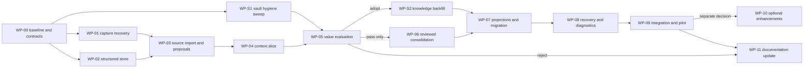

# Implementation work packages

This is an execution specification, not authorization to start implementation during the blueprint session. Each package requires its own reviewable diff and evidence. Paths are relative to AgentMem unless marked HX. Existing application files are retained. New Python files use stdlib unless a dependency is separately justified and pinned.

## Dependency order

WP-01 and WP-02 can run in parallel only with disjoint ownership and separate worktrees. WP-S1 changes the vault, not code, and can run beside them once A-4 is ready. WP-S2 runs after an adopt or adopt-partial verdict that covers extraction. Other packages are sequential because their contracts depend on prior results. The initial vertical slice is WP-00 through WP-05. It must demonstrate retrieval of a decision and rationale, an unresolved contradiction, and historical succession, with unchanged capture behavior and bounded output.

### Shared execution contract

Every package includes unit tests, public-interface integration tests, and baseline regression execution. Validation below uses `python` as an already verified Python 3.11+ executable. Resolve it once in WP-00; do not modify global PATH. Set temporary `AGENTMEM_HOME` and `OBSIDIAN_VAULT_PATH` in each test subprocess, disable real model/index calls, and prohibit production paths. Tests with `-I` explicitly insert the checkout root as current fixtures do.

Every mutation test asserts database contents and resulting files, not only a returned success envelope. Every negative test asserts no unintended write. Each definition of done also includes Codex's independent review and Claude's integration acceptance. If a specified future CLI differs from 04, amend the contract before coding it.

## WP-00: Freeze baseline and executable contracts

1. **Objective/value.** Make later improvement claims reproducible and preserve the user's hook behavior.
2. **Prerequisites.** Read 00-06 and 08-10; inspect actual checkout status and any new AGENTS instructions. No runtime deployment.
3. **Existing files.** `tests/fixtures.py`, both existing test modules, `hook.py`, `cli.py`, `integrations/opencode/agentmem.js`, `install.py`.
4. **Create/modify.** Create `tests/fixtures/knowledge/{manifest.json,corpus.json,queries.jsonl,expected.jsonl}`, `tests/test_knowledge_contracts.py`, `tools/evaluate_knowledge.py`, and `docs/llmwiki-evaluation/baseline.md`. Add `.audit/` to the AgentMem `.gitignore` before anything else; the repository is public. Set R is built later, after WP-S1, per 06. Do not change application behavior.
5. **Requirements.** Freeze B0 source and fixture hashes; capture 30-test baseline; define hook golden inputs and outputs for all events, alias fields, missing session ID, malformed JSON, pause, recursion, and child-session suppression. No benchmark measurements may be synthesized.
6. **Contracts.** Implement fixture schema from 06, result/report schema containing commit, versions, corpus hashes, actual counters, null missing costs, and verdict. The evaluator must distinguish unavailable QMD from an empty successful result.
7. **Steps.** Resolve interpreter; run baseline suite; write synthetic corpus; independently annotate gold; implement baseline CLI wrapper and fixed-budget packaging; add isolated hook harness with detached spawn mocked; freeze development/sealed partition hashes; record per provider whether pasted user content is marked (Q17); run baseline correctness and available timing measurements.
8. **Edges/errors.** Missing Python/QMD returns setup failure; unsupported provider format is reported, not skipped silently. Never execute `install.py` on the real user profile. Golden outputs exclude nondeterministic dates/paths through explicit placeholders only.
9. **Tests.** T01-T27 fixture validation; hook input matrix; baseline wrapper uses actual CLI; deliberate wrong answer must fail grader. Inject fake success output without persisted note and prove lifecycle grader fails.
10. **Acceptance.** Baseline report includes actual results, reproducible commands, no skipped mandatory scenarios, and all unknown external capabilities labeled. Sealed gold is not authored by the model under evaluation.
11. **Validation.** `python -B -I -m unittest discover -s tests -v`; `python -I tools/evaluate_knowledge.py --arm baseline --fixtures tests/fixtures/knowledge --output .audit/b0`. Tests exit 0; evaluator may report measured baseline limitations without calling candidate adoption passed.
12. **Rollback.** Remove only newly created synthetic fixture/evaluator files by reverting the package commit. No persistent system state exists.
13. **Definition of done.** Codex verifies a deliberately wrong implementation fails the grader; Claude records baseline commit and commands in the task checkpoint.
14. **Responsibilities.** OpenCode implements fixtures/harness; Codex owns gold review and anti-gaming tests; Claude freezes scope and accepts the report.
15. **Dependencies unlocked.** WP-01 and WP-02. No active mode or real-vault migration.

## WP-01: Make existing capture recovery evidence-consistent

1. **Objective/value.** Keep immutable notes, metadata, and retries consistent before adding knowledge structure.
2. **Prerequisites.** WP-00 accepted. Add failing synthetic reproducers first for R13-R15.
3. **Existing files.** `pipeline.py`, `adapters.py`, `notes.py`, `manifest.py`, `fsutil.py`, `tests/fixtures.py`.
4. **Create/modify.** Add `tests/test_knowledge_capture_recovery.py`; modify only the existing modules needed by the reproduced failures. No changes to hook settings or plugin events.
5. **Requirements.** Recovery must match full agent/session/part, reuse the originally persisted summary/evidence, bound old capture reprocessing to its recorded end, and reject corrupt create-once artifacts. Existing note names stay valid. Also implement the direction A items, each shippable with B1: A-1 stamps new session notes' frontmatter with the session repository HEAD (additive field, bounded read-only `git rev-parse`, null on failure); A-2 limits search's CURRENT label to hits inside the overview state block, labeling pending and recent-session hits separately without changing the JSON shape, and keeps the existing label with a recorded limitation where the hit cannot be located; A-3 instructs the legacy consolidation prompt to attach the commit to any repository-state line it writes; A-4 routes a session in a Git worktree (a `.git` file pointing into another repository's gitdir) to the parent repository's project, so worktrees stop creating separate projects; A-5 makes attribution content-based. For each capture part, score every candidate project deterministically: distinct files edited or written under its roots (weight 3 each, capped at 10 files), absolute paths under its roots stated in user messages (weight 2), its name or alias stated in user messages (weight 1), and the session cwd (weight 1). The highest score wins when it at least doubles the runner-up; otherwise cwd decides, as does a part with no content signals. An explicit pin in `projects.json` still wins over everything. Other projects scoring at least 3 are recorded as `related_projects`, and the session link is added to their recent-sessions block marked related. Each part is attributed on its own, so a resumed session that moves to other work moves with it. Note frontmatter records the winning project, the per-project signal counts, and the method (`content`, `cwd-fallback`, or `pinned`). Remembered items use the same scoring on their text. No model call is involved. SessionStart still picks its overview from cwd, because no content exists yet when a session starts.
6. **Contracts.** Add optional `end` cursor to adapter reads without changing the default whole-tail behavior. Persist a versioned capture recovery receipt under `_meta/capture-receipts/<sha256(agent,session,part)>.json` before note creation. Receipt includes identity, source range, summary, digest hash, chosen path, and content hash. It contains redacted data only. Existing notes without a receipt recover from validated frontmatter/body as legacy evidence; never resummarize them and pretend it is identical evidence.
7. **Steps.** Reproduce collision; add full-identity check; create receipt before note write; reuse receipt on retry; verify existing note bytes/hash; finish manifest transaction; retain receipt until capture and knowledge import can recover independently; implement exact-end reads; test partial/truncated transcripts; keep retry errors explicit. Receipt retention is 30 days after captured status, then removal is allowed because note and manifest suffice for later import.
8. **Edges/errors.** Same identity with changed bytes is `capture_identity_conflict`; no overwrite. A truncated source before its old cursor is not an empty success. OpenCode earlier-message mutation is a source-change error. If hard-link create is unavailable, do not claim atomic immutable creation; use a documented same-filesystem replace under an exclusive identity lock and verify receipt/hash before readers adopt it.
9. **Tests.** Crash before/after receipt, note, reconciliation, and manifest commit; two agents with identical suffix; resumed part; source disappears; malformed frontmatter; partial final JSONL line; model produces different summaries on retry; ensure only first receipt controls output. A-1 records null HEAD outside a repository; A-2 labels a pending-block hit as non-current; A-3 prompt contains the commit instruction; A-4 routes a synthetic worktree session to its parent project; A-5 attributes a session run from folder A that edits only project-B files and states a B path to B, keeps cwd for a session without content signals, keeps cwd on a near-tie, honors a pin, records related projects, and attributes two parts of one session to different projects when their work differs.
10. **Acceptance.** All old tests pass; R13-R15 and capture portion of R07 pass; successful capture has matching receipt/note/manifest evidence identity; hook golden tests unchanged.
11. **Validation.** `python -B -I -m unittest discover -s tests -p 'test_knowledge_capture_recovery.py' -v`, then full suite. Expected zero failures, no duplicate parts, unchanged old source-note hashes.
12. **Rollback.** Revert application commit, retain receipts as inert evidence. Do not delete captured notes or rewind cursors. Old runtime ignores new optional receipt files.
13. **Definition of done.** Codex independently injects at least one crash outside the worker's authored tests and verifies replay. Claude records any baseline change in B1.
14. **Responsibilities.** OpenCode implements bounded fixes; Codex reviews identity/cursor/crash logic; Claude integrates. This is critical logic and cannot be merged on self-review alone.
15. **Dependencies unlocked.** WP-03. B1 can ship independently only after a separate deployment decision.

## WP-02: Add the project-scoped transactional store

1. **Objective/value.** Store claim identity, provenance, revisions, and authority without relying on prose parsing.
2. **Prerequisites.** WP-00; final schema from 04. Can run alongside WP-01 in disjoint worktree.
3. **Existing files.** `config.py`, `projects.py`, `manifest.py` as reference only; do not alter manifest schema.
4. **Create/modify.** Create `knowledge/__init__.py`, `models.py`, `store.py`, `policy.py`; `tests/test_knowledge_store.py`. Add opt-in config fields in `config.py`.
5. **Requirements.** Implement all 04 logical tables except deferred ones, indexes, enums, cross-project checks, explicit schema version, operation idempotency, and project revisions. Store creation refuses a DB path inside a Git working tree unless Git ignores it (R29). Default feature off.
6. **Contracts.** Implement `import_capture`, `apply_proposal`, and `review_claim` transaction primitives with typed results. Source/claim values validate at boundaries. Actor/approval constraints remain explicit, not inferred from command invocation.
7. **Steps.** Write DDL and dataclasses; create schema transaction; implement online backup and integrity verification before any migration; register stable project ID; implement safe reads; implement operation hash replay; implement revision CAS and revision snapshots; add evidence/edge validation; implement cycle detection using bounded visited traversal; add transaction rollback tests. At this stage manual acceptance is available only through test/service calls, not an exposed CLI. Backup rotation/diagnostics follow in WP-08.
8. **Edges/errors.** Unknown schema, invalid UTF-8, duplicate IDs, case-colliding names, foreign project links, cycles, negative cursor, invalid interval, unsupported value type, same operation/different body, and busy exhaustion must fail without partial rows.
9. **Tests.** R06-R09, R20, R22; parallel processes competing for same revision; rollback after each insertion; orphan foreign key; exact operation replay. Confirm reads do not initialize/migrate the store.
10. **Acceptance.** One successful mutation increments project revision once; replay increments zero times; stale mutation writes zero rows; all linked rows remain within project.
11. **Validation.** `python -B -I -m unittest discover -s tests -p 'test_knowledge_store.py' -v`, full suite. Expected zero failures and SQLite integrity `ok` for each completed fixture DB.
12. **Rollback.** Feature remains off; retain or remove only synthetic DBs through test cleanup. No production migration or manifest change.
13. **Definition of done.** Codex signs off on transaction and cross-project invariants; Claude confirms no second authority was introduced accidentally.
14. **Responsibilities.** OpenCode schema and data access; Codex concurrency/identity review; Claude contract ownership.
15. **Dependencies unlocked.** WP-03.

## WP-03: Import sources and propose bounded claims

1. **Objective/value.** Recover durable statements with traceable evidence while keeping model output untrusted.
2. **Prerequisites.** WP-01 and WP-02 accepted.
3. **Existing files.** `adapters.py`, `extract.py`, `pipeline.py`, `llm.py`, `worker.py`, `remember.py`.
4. **Create/modify.** `knowledge/sources.py`, `proposals.py`; `tests/test_knowledge_sources.py`, `test_knowledge_proposals.py`; optional locator fields in Event; small post-capture integration seam only.
5. **Requirements.** Import every completed capture at most once per fingerprint; exact redacted span hashes; bounded legacy import; no raw transcript copy; no tool outputs; private/excluded policy before model call; model cannot assign accepted/verified authority. Persist valid proposal before apply.
6. **Contracts.** Proposal JSON is `{schema_version,source_id,base_revision,claims,relations}`. Each claim supplies kind, subject kind/key, predicate/value, statement/rationale, optional explicit effective dates, and support span ordinals/ranges. Relations refer to existing claim IDs or zero-based proposal claim indexes. Validator resolves them and rejects dangling references. Source metadata and actor fields are supplied by service only.
7. **Steps.** Add exact locators, speaker, and repo_head per span; extend capture receipts with capped redacted packets; enforce privacy before legacy summarize/consolidate, remember, and deferred-reconciliation calls; implement immutable import and durable unimported-capture scan; construct proposal input with relevant existing claims capped to 20; call isolated model outside locks; validate JSON limits and exact quote references; persist response; apply as reported; expose shadow reconcile service; keep legacy reconciliation running in shadow only where privacy permits.
8. **Edges/errors.** Missing transcript uses legacy-note evidence; local_only uses deterministic import and zero model calls; excluded stores content-free skip state; model timeout preserves pending job; schema-invalid output is rejected without automatic repeat; late fenced response cannot commit.
9. **Tests.** R01-R03, R13-R15, R18-R20; oversized response; fabricated source IDs; changed source hash; replayed capture; deterministic/no-model path; zero new authority from an assistant assertion.
10. **Acceptance.** Synthetic decision has exact source evidence and reported status; malicious proposal cannot call tools or cross projects; capture succeeds with store/model unavailable.
11. **Validation.** `python -B -I -m unittest discover -s tests -p 'test_knowledge_sources.py' -v`; same for proposals; full suite. Expected no network and zero unsupported verified rows.
12. **Rollback.** Disable post-capture seam; existing capture and legacy state continue. Preserve imported DB for inspection. No active overview changes exist.
13. **Definition of done.** Codex reviews actual serialized model inputs and outputs using synthetic canaries. Claude approves prompt version and records cost instrumentation limits.
14. **Responsibilities.** OpenCode import/model wrapper; Codex privacy and poisoning tests; Claude extraction scope and wording.
15. **Dependencies unlocked.** WP-04.

## WP-04: Deliver the bounded context vertical slice

1. **Objective/value.** Let a fresh agent recover a project decision, rationale, conflict, and source under a fixed context budget.
2. **Prerequisites.** WP-03; frozen baseline packaging and 04 retrieval contract.
3. **Existing files.** `search.py`, `cli.py`, `projects.py`, `hook.py` as compatibility reference.
4. **Create/modify.** `knowledge/retrieval.py`, `knowledge/cli.py`; register `context` and initial read-only knowledge commands in `cli.py`; `tests/test_knowledge_context.py`.
5. **Requirements.** Project-scoped DB authority, fixed rank fusion, bounded QMD time/candidates/graph hops, no query-time model, accurate freshness/uncertainty labels including user_stated and repo_moved per 04, hard budget including envelope. Keep `search --json` list shape unchanged.
6. **Contracts.** Implement ContextRequest/Response from 04. The offline fallback must label its unit per 04. Inject qmd client, tokenizer, and clock for tests. Return structured unavailable error if authoritative DB unavailable.
7. **Steps.** Implement scope resolution; eligible record selection; direct lexical ranks; QMD mapping/validation; fusion; bounded neighbor expansion; atomic evidence bundles; priority packaging; final budget count; JSON/text renderers; CLI error codes. Introduce a real subprocess timeout in QMD wrapper via optional parameter rather than changing existing search defaults.
8. **Edges/errors.** Empty query, budget below minimum, unsupported tokenizer, zero hits, huge conflict group, timeout, malformed QMD JSON, stale pages, traversal/UNC paths, no current project, archived project, and missing evidence all have explicit results.
9. **Tests.** T01-T15, T21-T27; R09-R11/R21/R26. Run a fresh CLI process after capture to establish continuity. Prove metadata/citations are counted by a near-boundary fixture.
10. **Acceptance.** Vertical slice answers all canonical synthetic cases correctly; zero model calls on reads; old CLI tests and hook goldens pass.
11. **Validation.** `python -B -I -m unittest discover -s tests -p 'test_knowledge_context.py' -v`; `python -I tools/evaluate_knowledge.py --arm candidate --fixtures tests/fixtures/knowledge --output .audit/k-slice`. Correctness must pass; adoption evaluated in WP-05.
12. **Rollback.** Feature off; remove new command registration by revert. Legacy search and capture stay usable.
13. **Definition of done.** Codex independently compares CLI output to gold and validates no candidate text bypasses DB checks; Claude demonstrates the slice to a fresh agent using the emitted package alone.
14. **Responsibilities.** OpenCode CLI/ranking/packaging; Codex independent retrieval and isolation tests; Claude integration demonstration.
15. **Dependencies unlocked.** WP-05, not active rollout.

## WP-05: Decide whether the structure earns its cost

1. **Objective/value.** Prevent investment in a system that is more complex without being more useful.
2. **Prerequisites.** WP-04 and frozen sealed fixtures; review benchmark-checklist skill before measurements.
3. **Existing files.** Evaluation runner and fixtures from WP-00; B0/B1/K worktrees.
4. **Create/modify.** `docs/llmwiki-evaluation/{comparison.md,results.json,environment.json}`; grader fixes only if independently shown wrong, with fresh sealed cases afterward.
5. **Requirements.** Run all four arms; separate deterministic correctness from real-model extraction; measure latency, actual tokens, cost, review burden, and quality. Report negative results.
6. **Contracts.** Apply the WP-05 slice-adoption gate defined in 06, not the later full release gate. Result verdict is adopt, adopt-partial, reject, or inconclusive, with decision_scope=slice and a per-question-class winner table (02). G8 and unfinished projection/recovery cases are not applicable until WP-09, never marked passed early. Unmeasured fields are null with reason.
7. **Steps.** Recheck hashes; calibrate provisional thresholds on development partition; freeze changes; run sealed evaluation; inspect every safety error; run scale and crash cases; perform blind answer review; calculate paired intervals; issue adoption verdict.
8. **Edges/errors.** Missing optional model/QMD run means inconclusive for that feature, not assumed success. Baseline near ceiling uses the defined >=95% condition. Unstable timing requires rerun with documented conditions, not cherry-picking.
9. **Tests.** Grader false-positive controls; fixture leakage audit; deterministic rerun produces same correctness; random seed repeatability; failures preserved in report.
10. **Acceptance.** G0/G1/G3 and the implemented store/capture portion of G7 pass; G2/G4/G5/G6 meet calibrated thresholds or verdict is reject/inconclusive. G2 is evaluated on K0 and on set R; K alone cannot pass it. Full G7 and G8 remain future release conditions. No real active migration is authorized by this slice verdict.
11. **Validation.** Evaluation commands for baseline, reliability, candidate from 06; full suite. Expected evaluator exit 0 for adopt or adopt-partial, 1 reject, 3 inconclusive.
12. **Rollback.** Keep WP-01 as optional reliability improvement; leave knowledge off/shadow. Do not delete evaluation evidence or force direction C as fallback.
13. **Definition of done.** Codex independently reproduces one quality and one performance result; Claude signs the decision with evidence references.
14. **Responsibilities.** OpenCode operates harness and collects artifacts; Codex owns independent measurement audit; Claude decides adoption against frozen gates.
15. **Dependencies unlocked.** WP-06 only on adopt. Otherwise stop broader work.

## WP-06: Add explicit review and conflict resolution

1. **Objective/value.** Preserve actual accepted decisions and their rationale without silently resolving conflicting reports.
2. **Prerequisites.** WP-05 adopt; 04 state machine and authority boundary reviewed.
3. **Existing files.** `remember.py`, `knowledge/policy.py`, `store.py`, `cli.py`.
4. **Create/modify.** Review/supersede/conflicts commands, their operator short forms, and the pending review queue; `tests/test_knowledge_review.py`; operator-facing review usage documentation.
5. **Requirements.** Acceptance/retraction/restoration/supersession with reasons and approval references; immutable revision snapshots; cycle checks; known conflict bundles. Existing `mem remember` still creates evidence but does not silently imply operator approval of every agent-issued command.
6. **Contracts.** ReviewRequest includes operation_id, project_id, claim_id, expected_project_revision, expected_claim_revision, action, reason, actor, approval_ref. SupersedeRequest additionally names predecessor and successor, with effective boundary when known.
7. **Steps.** Implement policy preconditions; transaction tests; CLI validation; conflict listing; explicit decision succession; distinguish manual evidence from authoritative approval; expose review history and safe JSON result.
8. **Edges/errors.** Already superseded/retracted claims, conflicting successors, unknown effective date, same-ID successor, cyclic chain, missing approval artifact, stale revision, and reused operation ID reject or return exact replay. Do not infer actor=operator from an agent-provided source.
9. **Tests.** R02-R04/R20/R21/R28; T03-T05/T10; retain old rationale exactly when a successor is accepted; one transaction resolves the selected conflict and cannot leave both sides silently current.
10. **Acceptance.** All authority changes have operation records and reasons; no model proposal can reach review mutation without explicit command; UI/CLI states match schema.
11. **Validation.** `python -B -I -m unittest discover -s tests -p 'test_knowledge_review.py' -v`, full suite and temporal/contradiction evaluation subset. Expected zero forbidden transitions.
12. **Rollback.** Disable review commands, retain immutable operations and revisions. Never roll back by deleting approvals from history.
13. **Definition of done.** Codex attacks acceptance bypass and supersession cycles; Claude reviews the user-visible authority language.
14. **Responsibilities.** OpenCode command and policy implementation; Codex authority testing; Claude explicit material-decision review.
15. **Dependencies unlocked.** WP-07.

## WP-07: Project Markdown and reversible migration

1. **Objective/value.** Give agents and the user navigable wiki pages without breaking Obsidian paths or existing hooks.
2. **Prerequisites.** WP-06; approved 04 schema; store backup helper from WP-02. No dependency on unfinished WP-08 work.
3. **Existing files.** `notes.py`, `projects.py`, `pipeline.py`, `search.py`, `hook.py`.
4. **Create/modify.** `knowledge/projection.py`, migration portion of `maintenance.py`; `tests/test_knowledge_projection.py`, `test_knowledge_migration.py`.
5. **Requirements.** Render project-local entity/claim/decision pages with IDs, status, revision, source links; never write the existing overview; write `knowledge/index.md` last; detect editor drift on generated pages; shadow/active/off separation.
6. **Contracts.** Generated paths are `knowledge/claims/<claim_id>.md`, `knowledge/entities/<entity_id>.md`, and `knowledge/index.md`. Decisions are claims with kind=decision, not a second duplicate ADR authority. Existing ADRs remain untouched and linked as sources. Page header includes schema_version, project_id, entity/claim ID, project_revision, and generated=true.
7. **Steps.** Pure render functions first; source-link validation; shadow projection; outbox replay; migration dry-run fingerprint; idempotent import/apply; single revision-checked mode switch; filter generated knowledge pages from legacy search/fallback without changing the old JSON shape; rollback preview and restore; QMD refresh after successful active projection; run the fresh full-QMD holdout from 06.
8. **Edges/errors.** Human-edited page, malformed markers, case-insensitive filename collision, archived project, missing source, long paths, Windows file contention, stale render revision, and crash between pages. Never overwrite unmanaged text or old ADRs.
9. **Tests.** R16/R23/R25/R26/R27; edit a generated page before render and confirm external_edit and skip; overview bytes unchanged across render and mode switch; byte-equality of source notes; interrupted projection replay; mixed-revision pages cannot alter DB context; import dry-run writes nothing.
10. **Acceptance.** Synthetic Obsidian link inventory resolves all generated links; zero source-note mutations; rollback relocates generated pages and leaves the overview untouched; all hook golden outputs remain compatible.
11. **Validation.** Projection and migration unittest modules, full suite, `mem knowledge import --project Synthetic --dry-run --json` through isolated CLI. Expected stable plan hash for identical inputs, no production path changes.
12. **Rollback.** Set mode off, relocate generated pages out of indexed path, refresh QMD. Retain DB and evidence.
13. **Definition of done.** Codex independently tests crash/editor race and rollback; Claude reviews actual Markdown in Obsidian or a plain reader and checks navigation.
14. **Responsibilities.** OpenCode rendering/import; Codex migration invariants; Claude visual/readability and mode switch acceptance.
15. **Dependencies unlocked.** WP-08; no real project activation before WP-09.

## WP-08: Recovery, privacy, and bounded operations

1. **Objective/value.** Make the new authority supportable under outages, corruption, and growth.
2. **Prerequisites.** WP-07 and WP-02 online backup helper. This package adds orchestration, retention, diagnostics, and restore drills.
3. **Existing files.** `logutil.py`, `config.py`, `worker.py`, knowledge store/projection.
4. **Create/modify.** Complete `knowledge/maintenance.py`; status/doctor/repair/backup/export commands; `tests/test_knowledge_recovery.py`, `test_knowledge_privacy.py`.
5. **Requirements.** Online backup, integrity restore drill, Git-tracking check (R29), fenced retries, operational retention, extraction quotas, safe logs, excluded/local-only policies, missing-source detection, and explicit degraded outcomes.
6. **Contracts.** BackupResult contains backup_id, schema_version, project revisions, file hash, integrity result, and timestamp. DoctorResult contains check IDs, status, safe references, and repairable boolean. It never claims repairs occurred during read-only inspection.
7. **Steps.** Implement online backup and manifest; verify restore in temp; add daily backup precondition; implement job lease recovery; add status counts; integrity checks; safe repair; export; retention bounded to verified rules; canary privacy tests; operational runbook including manual purge inventory.
8. **Edges/errors.** Full disk, locked files, invalid DB, corrupt backup, missing backup destination, old schema, machine clock jump, index unavailable, quota exhausted, and crash during backup rotation. Preserve last verified backup.
9. **Tests.** R07/R10-R12/R17-R19/R22-R24/R29; zero source text in logs; restore into new process; lost knowledge DB must not pretend approval can be rebuilt from prose.
10. **Acceptance.** Restore reproduces accepted/reported/superseded states and query outputs; failed backup blocks only knowledge mutations; capture remains available; doctor identifies injected faults.
11. **Validation.** Recovery/privacy unittest modules, full suite, isolated CLI backup/doctor/repair sequence. Expected integrity `ok`, exact revision restoration, and no synthetic canary leaks.
12. **Rollback.** Knowledge off; preserve backups and DB; release legacy capture independently. No global cleanup, source deletion, or credentials changes.
13. **Definition of done.** Codex runs an independent restore drill and privacy audit; Claude approves diagnostics and support instructions.
14. **Responsibilities.** OpenCode ops commands; Codex failure injection and privacy; Claude operator runbook.
15. **Dependencies unlocked.** WP-09.

## WP-09: Integrate without changing hooks and run pilot

1. **Objective/value.** Deliver useful persistent knowledge while preserving the user's normal agent lifecycle.
2. **Prerequisites.** WP-08 and G0-G7 pass; explicit pilot project selection; live Herdr/Python blockers resolved through normal authorized setup, not bypasses.
3. **Existing files.** `install.py`, integration skills, `run.py`, worker/CLI; HX docs only for correcting unsupported promotion claims.
4. **Create/modify.** App-only installer mode with temporary-home tests; integration skill instructions; `tests/test_knowledge_integration.py`; pilot/rollback report. No hook/plugin contract edits.
5. **Requirements.** Before the first real-vault knowledge artifact, add the 03 ignore entries to the vault `.gitignore` with the user's approval; this is a vault governance change. Deploy new app at existing path with rollback copy; app-only mode must not modify hooks, plugin, skills, index, PATH, credentials, or provider state unless separately selected. Update shared skill source through pstack workflow only when explicitly in deployment scope. Do not implement HX promotion as hidden scope.
6. **Contracts.** `install.py --app-only` runs tests and deploys app only. Its result reports app hashes and untouched integration hashes. Existing installer behavior stays unchanged unless a reviewed bug requires correction.
7. **Steps.** Implement/test app-only deployment in synthetic home; record live integration hashes; deploy after concrete release review; run one fresh session per provider; observe enqueue, settle/end, immutable note, import, context; test PAUSE/resume; activate one approved project; operate 20-session pilot; evaluate G8; expand only after report.
8. **Edges/errors.** Hook trust prompt, unavailable interpreter, elevated Herdr server, missing provider, QMD mismatch, or failed rollback check stop affected live validation. Never restart Herdr or rewrite global settings to make the gate pass without user authorization.
9. **Tests.** R27; all provider contract fixtures; coexistence with existing Herdr/HX hooks; runtime/checkout hash match; overview untouched by the knowledge writer; end-to-end fresh-process continuity.
10. **Acceptance.** Settings/plugin hashes unchanged; all providers' observed capture evidence recorded; no unresolved P1/P2; pilot meets G8 and rollback drill passes. An untested provider remains explicitly blocked, not accepted by analogy.
11. **Validation.** Full suite; app-only installer synthetic test; isolated evaluation; live `mem knowledge doctor --json`, context queries, and source-note/hash inspection. Expected observed artifacts, not merely exit 0.
12. **Rollback.** Restore previous app at stable path, knowledge mode off, keep source notes/cursors. Verify fresh session capture on restored app.
13. **Definition of done.** Claude owns final live acceptance and records release commit; Codex independently reviews all critical diffs and pilot failures. No push/deploy beyond explicitly authorized scope.
14. **Responsibilities.** OpenCode app-only deployment/tests/skill draft; Claude integration and pilot; Codex independent regression review and rollback proof.
15. **Dependencies unlocked.** Release decision. Optional work requires a new value hypothesis.

## WP-S1: Vault hygiene sweep, before the new system

1. **Objective/value.** Clean the existing vault so both the current setup and the new one work from correct project boundaries. On 2026-10-21, 13 of 27 project folders were worktree or branch copies of other projects, a pre-PARA folder remained beside its replacement, and overview state blocks carried stale repository facts. The benefit lands for the current setup even if WP-05 rejects the new one.
2. **Prerequisites.** WP-00 accepted. A-4 from WP-01 ready, so fragments do not reappear after the sweep. Vault `AGENTS.md` governance read. User approval of the sweep plan.
3. **Existing files.** `projects.py`, `_meta/projects.json`, `notes.py` managed blocks, QMD index, and the earlier pre-PARA migration, whose script was deliberately kept out of the repository.
4. **Create/modify.** Local-only `tools/vault_sweep.py` and `.audit/sweep/<date>/plan.json`, both git-ignored like the earlier migration script, because they contain vault-specific names. Generic logic that is useful later, such as worktree-parent detection, may live in `projects.py` with synthetic tests. Vault changes happen only through the approved plan.
5. **Requirements.** A dry run writes nothing and produces a plan with five sections. (a) Fragment projects and their proposed parent, from Git worktree linkage, shared remotes, and name similarity, each marked evidence-based or guess. (b) Leftover or duplicate folders from earlier layouts. (c) Overview lines that state repository facts, beside the repository's current HEAD. (d) Broken wiki links. (e) Unsorted sessions with suggested projects. (f) Past captures whose content-based attribution (A-5), re-scored from the session note's file and command metadata and first prompt, disagrees with the project they were filed under. The user approves or edits each item. Only approved items are applied. Items are moved, never deleted. Session notes are never edited or moved.
6. **Contracts.** The parent overview keeps its own state block. A fragment's state and pending content is appended to the parent's pending block under a dated "Merged from <fragment>" heading for review, never merged into state automatically. Fragment folders move to `4-Archive/merged/<fragment>/`. `projects.json` adds the fragment's roots to the parent. Approved stale repository lines are prefixed in place with "(as of unknown commit)"; no model rewrites them. An approved re-attribution writes an entry to `_meta/attribution-overrides.json`, updates the capture's project in the manifest, and moves the session link between the two projects' recent-sessions blocks. The immutable session note is not edited; its frontmatter `project` means the project at capture time, and readers apply the override.
7. **Steps.** Pause capture with PAUSE; commit a vault snapshot locally, including all uncommitted changes; run the dry run; present the plan with counts; get approval; apply; rebuild the QMD index; run the link inventory; remove PAUSE; confirm a fresh capture routes to the parent project.
8. **Edges/errors.** A fragment without an evidence-based parent stays where it is and is listed. Archive name collisions get a numeric suffix. A locked file aborts only its item. Any failure leaves the snapshot plus completed items, logged.
9. **Tests.** Synthetic vault fixture with worktree fragments, a look-alike name without a worktree link, a leftover layout folder, stale repository lines, and broken links. The dry run writes nothing; apply moves exactly the approved items; session-note bytes are unchanged; a rerun is a no-op.
10. **Acceptance.** Approved items applied; zero session-note changes; no new broken links; one fresh capture per active agent routes correctly; SessionStart output still renders for merged parents.
11. **Validation.** Fixture tests; on the real vault, `git -C <vault> diff --stat <snapshot>` matches the approved plan.
12. **Rollback.** `git -C <vault> reset --hard <snapshot>` restores every tracked file, then rebuild the QMD index. The snapshot includes the previously uncommitted changes, so nothing is lost by resetting.
13. **Definition of done.** User accepts the result in Obsidian; Codex reviewed the merge-evidence rules for false merges.
14. **Responsibilities.** OpenCode builds the dry-run tool against the fixture; Codex reviews merge rules; Claude runs it on the real vault with the user.
15. **Dependencies unlocked.** Set R is written after this package. WP-05 needs both.

## WP-S2: Knowledge backfill, after adoption

1. **Objective/value.** Give the new system the vault's history, not only new sessions. Without it, past decisions appear only through the shallow legacy import in 03.
2. **Prerequisites.** WP-05 verdict adopt, or adopt-partial covering extraction; WP-S1 done; privacy policy set for every enrolled project.
3. **Existing files.** `knowledge/sources.py`, `proposals.py`, the legacy import in 03, session notes, capture receipts where present.
4. **Create/modify.** `mem knowledge backfill --project P --dry-run|--apply PLAN_HASH --json` in `knowledge/cli.py` and `maintenance.py`; `tests/test_knowledge_backfill.py`.
5. **Requirements.** The dry run reports per project: sessions, eligible sessions, estimated model calls (one per session), and estimated tokens from recorded summary sizes. Apply processes sessions oldest first, so recorded times run forward. It uses the normal proposal pipeline, so everything lands as reported and nothing is accepted. local_only projects get the deterministic legacy import only; excluded projects get nothing. Sources are the immutable session notes (`legacy_note`) unless a receipt exists. Each run has a budget cap and is resumable and idempotent by session identity.
6. **Contracts.** Proposal schema and limits from 04. The plan hash covers the session list and prompt version; drift forces a new dry run.
7. **Steps.** Dry run per project; user approves the spend; run in batches under the per-run budget; render shadow pages; spot-check 10 random claims per project against their source notes; the project may then move to active through WP-07.
8. **Edges/errors.** Malformed notes are skipped and listed. Notes from merged fragments are attributed to the parent through `projects.json`. A model outage pauses the backfill with progress kept.
9. **Tests.** Oldest-first ordering, idempotent rerun, budget stop and resume, privacy policies, fragment attribution.
10. **Acceptance.** Every eligible session imported once; spot-check precision recorded in the pilot report; zero accepted claims created.
11. **Validation.** Test module, plus `knowledge status` counts matching the dry run.
12. **Rollback.** Backfilled claims carry the backfill operation IDs; a project can be restored to its pre-backfill revision from the verified backup.
13. **Definition of done.** User approved the spend; spot check done; Codex reviewed ordering and idempotency.
14. **Responsibilities.** OpenCode implements; Codex reviews; Claude runs it and the spot check.
15. **Dependencies unlocked.** WP-07 activation of backfilled projects.

## WP-11: Update documentation everywhere it describes AgentMem

1. **Objective/value.** Make every description of AgentMem match what was actually shipped and measured, so nothing public or agent-facing describes the old system or overstates the new one. This runs at the end whichever way WP-05 goes. After a reject verdict it still documents the direction A fixes and the vault sweep.
2. **Prerequisites.** WP-09 accepted, or a WP-05 reject verdict with B1 and WP-S1 shipped. Final evaluation report available.
3. **Existing files.** AgentMem: `README.md` (its test count is already stale), `docs/ASSESSMENT.md`, `integrations/skill/{memory,obsidian,remember}/SKILL.md`. Vault: `AGENTS.md` (layout, commands, retrieval labels). HX repository: `README.md`, `docs/ARCHITECTURE.md`, `skills/hx-router/SKILL.md`, including the unimplemented promotion claim (Q12). Portfolio website repository: `src/content/projects/agentmem.md`, `src/pages/about.astro`, `src/data/artifacts.ts`, and `src/data/github.json`, which is regenerated by `scripts/fetch-github.mjs`, not hand-edited. The making-of paper `public/writing/how-this-site-was-built/` does not mention AgentMem today; change it only if the user wants the memory system in that story.
4. **Create/modify.** Edits to the files above; a short `docs/llmwiki-blueprint/RELEASE-NOTES.md` recording what shipped versus what the blueprint proposed. Shared skills change only through the pstack source and `sync.py`, never in `~/.claude/skills` directly.
5. **Requirements.** Each statement must trace to the final evaluation report or shipped code. Measured gains are quoted with their test set and caveats; unmeasured benefits are not claimed. Commands, folders, and labels match the shipped CLI. Public text (website, public repositories) contains no vault content: no note text, session titles, project names from the vault, or real-vault questions and answers. Use synthetic examples.
6. **Contracts.** Agent-facing docs (skills, vault `AGENTS.md`) describe exactly the commands an agent may run and the review rule from 04. Website copy follows the portfolio repository's own content and design rules.
7. **Steps.** List every mention with a search across the four repositories and the vault; draft changes per file; check each claim against the report; run each repository's own checks (AgentMem tests, pstack `sync.py --check`, the website build and tests); show the user the website diff before any deployment.
8. **Edges/errors.** If the website has release gates of its own, follow them; this package does not authorize deployment. If WP-05 was adopt-partial, describe only the question types that shipped.
9. **Tests.** AgentMem docs: every command in README and skills runs with `--help` in an isolated environment. A scan of all public diffs finds no vault paths, session-note filename patterns, or project names from the local project map (R34).
10. **Acceptance.** No stale description of capture, retrieval, or project state remains in the listed files; every quantitative claim cites the report; the public-content scan is clean.
11. **Validation.** AgentMem full suite; pstack `sync.py --check`; the website's build and test commands; the R34 scan.
12. **Rollback.** Revert the documentation commits per repository. A website deployment is rolled back through that repository's own process.
13. **Definition of done.** User approves the website and paper text; Codex checks the claims against the report; Claude confirms the agent-facing docs match the CLI.
14. **Responsibilities.** Claude drafts prose and owns accuracy; OpenCode makes the mechanical edits; Codex checks claims against evidence.
15. **Dependencies unlocked.** Release complete. Website deployment is a separate user decision.

## WP-10: Optional enhancements, not release requirements

1. **Objective/value.** Address measured remaining retrieval gaps only after the core pilot succeeds.
2. **Prerequisites.** WP-09 accepted and a specific failed query class documented.
3. **Existing files.** Knowledge retrieval and maintenance; HX checkpoint interface only if separately approved.
4. **Expected files.** Narrow tests and module changes selected by a new brief. No speculative placeholder modules now.
5. **Requirements.** Choose one enhancement per brief: improved hybrid ranking, bounded topic synthesis, explicit HX checkpoint promotion, overview state-block takeover using the deferred protocol in 03, or the artifact-based `verify` command in 04. Cross-project graphs, graph DBs, raw transcript archive, and autonomous acceptance remain out of scope.
6. **Contracts.** Reuse project IDs, source provenance, operation IDs, and context budget. A promotion source must carry checkpoint path/hash and task identity, and must be treated as reported evidence.
7. **Steps.** Freeze failed cases; write expected outputs; compare simpler alternatives; implement one change; run paired eval; retain only measured improvement.
8. **Edges/errors.** No new dependency on HX for capture; no promotion inside HX lease mutation callbacks; no recurring synthesis without a bounded budget and source invalidation rules.
9. **Tests.** Add independent gold cases for the named gap, plus all prior safety and compatibility tests.
10. **Acceptance.** Named metric improves with no invariant regression; cost and maintenance changes recorded.
11. **Validation.** Existing suite and evaluator plus exact commands in the new brief. No enhancement starts without those commands.
12. **Rollback.** Feature flag off and revert its isolated commit; preserve evidence.
13. **Definition of done.** Independent review and renewed value decision.
14. **Responsibilities.** OpenCode routine implementation; Codex architecture/critical tests; Claude scope and integration.
15. **Dependencies unlocked.** None automatically. This is not permission to build every listed enhancement.
